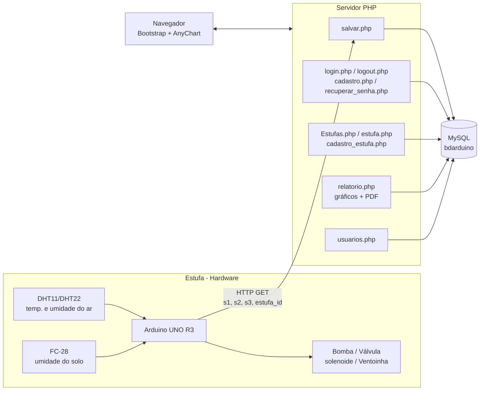
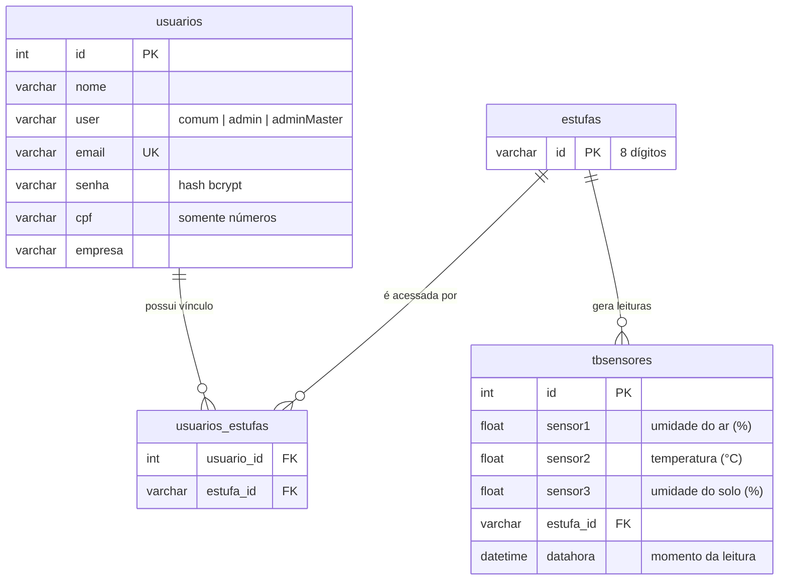

# Green Hills – Estufa Automatizada Inteligente

> Trabalho de Conclusão de Curso do Curso Técnico em Desenvolvimento de Sistemas – ETEC Fernando Prestes


---

## Sumário

1. [Visão geral](#1-visão-geral)
2. [Requisitos](#2-requisitos)
3. [Tecnologias utilizadas](#3-tecnologias-utilizadas)
4. [Arquitetura](#4-arquitetura)
5. [Estrutura do repositório](#5-estrutura-do-repositório)
6. [Pré-requisitos](#6-pré-requisitos)
7. [Instalação, configuração e execução](#7-instalação-configuração-e-execução)
8. [Configuração (credenciais e parâmetros)](#8-configuração-credenciais-e-parâmetros)
9. [Banco de dados](#9-banco-de-dados)
10. [Documentação da API e das rotas](#10-documentação-da-api-e-das-rotas)
11. [Segurança](#11-segurança)
12. [Testes](#12-testes)
13. [Deploy](#13-deploy)
14. [Limitações conhecidas e melhorias futuras](#14-limitações-conhecidas-e-melhorias-futuras)
15. [Equipe](#15-equipe-de-desenvolvimento)
16. [Licença](#16-licença)

---

## 1. Visão geral

### 1.1 Objetivo

O **Green Hills** é uma solução de automação para estufas agrícolas que permite **monitorar e controlar as condições ambientais de forma remota e inteligente**. Sensores conectados a um **Arduino** coletam os dados da estufa, que são armazenados em um banco MySQL e exibidos em uma aplicação web responsiva, com gráficos e relatórios.

### 1.2 Problema que resolve

O cultivo em estufas depende de manter temperatura, umidade do ar e umidade do solo dentro de faixas adequadas. Quando esse acompanhamento é manual, ocorrem:

- **Perdas de produção** por irrigação ou ventilação feitas fora do momento ideal;
- **Desperdício de água** e energia;
- **Falta de histórico** para analisar o comportamento da estufa ao longo do tempo;
- **Necessidade de presença física** do produtor para verificar as condições.

O Green Hills centraliza as leituras, automatiza ações (irrigação e ventilação) e entrega relatórios para apoiar o **cultivo de precisão** e a agricultura sustentável.

### 1.3 Escopo

**Dentro do escopo**

- Coleta de temperatura ambiente, umidade do ar e umidade do solo via Arduino.
- Armazenamento histórico das leituras por estufa.
- Acionamento automatizado de irrigação (bomba/válvula solenoide) e ventilação (ventoinha).
- Aplicação web com autenticação e três níveis de acesso.
- Vínculo de usuários a estufas por meio de um código de 8 dígitos.
- Relatórios com gráficos interativos e exportação em PDF.

**Fora do escopo**

- Aplicativo móvel nativo (a interface web é responsiva).
- Notificações push/e-mail de alertas.
- Controle manual remoto dos atuadores pela interface web.
- Integração com serviços de nuvem/IoT de terceiros.

---

## 2. Requisitos

### 2.1 Requisitos funcionais

| ID | Requisito |
|----|-----------|
| RF01 | O sistema deve permitir login e logout de usuários com controle de sessão. |
| RF02 | Usuários `admin` e `adminMaster` devem cadastrar novos usuários informando nome, tipo, e-mail, CPF, empresa e senha. |
| RF03 | O sistema deve validar CPF (formato e dígitos verificadores) e rejeitar e-mails duplicados no cadastro. |
| RF04 | O sistema deve oferecer recuperação de senha. |
| RF05 | O usuário autenticado deve conectar-se a uma estufa existente informando o **ID de 8 dígitos**. |
| RF06 | O sistema deve receber e armazenar as leituras enviadas pelo Arduino (umidade do ar, temperatura e umidade do solo) associadas a uma estufa. |
| RF07 | O usuário deve visualizar as leituras da estufa à qual está vinculado, em tabela ordenada da mais recente para a mais antiga. |
| RF08 | O sistema deve exibir gráficos com médias do **dia, da semana e do mês** e médias **por dia da semana** (últimos 7 dias). |
| RF09 | O usuário deve exportar os dados dos sensores em **PDF**. |
| RF10 | Administradores devem gerenciar os usuários cadastrados. |
| RF11 | O hardware deve acionar **irrigação** e **ventilação** automaticamente conforme as leituras dos sensores. |
| RF12 | O sistema deve apresentar páginas de ajuda e de apresentação da equipe. |

### 2.2 Perfis de usuário

| Perfil | Permissões |
|--------|-----------|
| `adminMaster` | Controle total; pode cadastrar usuários de qualquer tipo (inclusive outros `adminMaster`). |
| `admin` | Gerencia usuários; pode cadastrar usuários `comum` e `admin`. |
| `comum` | Acesso de visualização (estufas vinculadas e relatórios). |

### 2.3 Requisitos não funcionais

| ID | Categoria | Requisito |
|----|-----------|-----------|
| RNF01 | Segurança | Senhas armazenadas com `password_hash` (bcrypt). |
| RNF02 | Segurança | Acesso às páginas restrito por sessão e tipo de usuário. |
| RNF03 | Usabilidade | Interface responsiva (Bootstrap 5) utilizável em desktop e celular. |
| RNF04 | Portabilidade | Execução em qualquer servidor com Apache/Nginx + PHP 8.1 + MySQL 8.0 (XAMPP, WAMP ou Docker). |
| RNF05 | Desempenho | Gravação de leituras em tempo curto o bastante para atualização contínua (ex.: a cada poucos segundos/minutos, conforme o firmware). |
| RNF06 | Manutenibilidade | Código PHP comentado, separando conexão, cabeçalho comum e páginas. |
| RNF07 | Compatibilidade | Funcionar nas versões atuais de Chrome, Firefox e Edge. |
| RNF08 | Confiabilidade | O sistema deve retornar mensagens padronizadas (`insert_ok`, `insert_error`, `conexao_error`) à comunicação do Arduino. |

---

## 3. Tecnologias utilizadas

### Hardware

| Componente | Função |
|-----------|--------|
| Arduino UNO R3 | Microcontrolador que lê sensores e comanda atuadores |
| Sensor DHT11 / DHT22 | Temperatura e umidade do ar |
| Sensor FC-28 | Umidade do solo |
| Bomba d'água + válvula solenoide | Irrigação automática |
| Ventoinha | Ventilação |
| Protoboard, jumpers e estrutura física | Montagem do protótipo da estufa |

### Software

| Camada | Tecnologia |
|--------|-----------|
| Front-end | HTML5, CSS3, JavaScript, Bootstrap 5.3.3, Font Awesome 6.5.2 |
| Back-end | PHP 8.1 (MySQLi e PDO) |
| Banco de dados | MySQL 8.0 |
| Gráficos | AnyChart 8 (colunas 3D e área 3D) |
| PDF | TCPDF |
| Máscaras de formulário | Cleave.js 1.6.0 (CPF) |
| Servidor local | XAMPP, WAMP ou Docker |
| Firmware | C/C++ (Arduino IDE) |

---

## 4. Arquitetura

O sistema é composto por **três blocos**: o **hardware** (Arduino + sensores/atuadores), o **servidor web** (PHP) e o **banco de dados** (MySQL). O Arduino envia as leituras por requisição HTTP `GET` ao script `salvar.php`; a interface web consulta o mesmo banco para exibir tabelas, gráficos e PDF.



### 4.1 Fluxo de dados das leituras

1. O Arduino lê DHT (umidade do ar e temperatura) e FC-28 (umidade do solo).
2. Com base nas leituras, o firmware aciona irrigação e/ou ventilação.
3. O Arduino envia `GET /salvar.php?s1=…&s2=…&s3=…&estufa_id=…`.
4. `salvar.php` insere a leitura na tabela `tbsensores` (a coluna `datahora` registra o momento).
5. O usuário abre `relatorio.php?estufa_id=…`; o sistema confirma o vínculo do usuário com a estufa, calcula as médias e desenha os gráficos.

### 4.2 Mapeamento dos sensores

| Campo no banco | Grandeza | Exibição |
|----------------|----------|----------|
| `sensor1` / `s1` | Umidade do ambiente (%) | "Umid Ambient %" |
| `sensor2` / `s2` | Temperatura do ambiente (°C) | "Temp Ambient °C" |
| `sensor3` / `s3` | Umidade do solo (%) | "Umid Do Solo %" |

### 4.3 Organização dos componentes

| Arquivo | Responsabilidade |
|---------|------------------|
| `Index.php` | Página inicial / apresentação do sistema |
| `header.php` | Cabeçalho/navegação reutilizado nas páginas |
| `login.php`, `logout.php` | Autenticação e encerramento de sessão |
| `cadastro.php` | Cadastro de usuários (restrito a `admin`/`adminMaster`), com validação de CPF |
| `recuperar_senha.php` | Recuperação de senha |
| `usuarios.php` | Gerenciamento de usuários |
| `Estufas.php`, `estufa.php` | Listagem e detalhe das estufas do usuário |
| `cadastro_estufa.php` | Vincula o usuário a uma estufa pelo ID de 8 dígitos |
| `relatorio.php` | Tabela de leituras, médias, gráficos AnyChart e PDF (TCPDF) |
| `salvar.php` | **Endpoint** que recebe as leituras do Arduino |
| `conexao.php` | Conexão MySQLi (páginas web) |
| `conexaoArduino.php` | Conexão PDO (endpoint do Arduino) |
| `Ajuda.php` | Página de ajuda |

---

## 5. Estrutura do repositório

```text
TCC-Green-Hills/
├── Base de Dados/            # Script SQL do banco (bdarduino)
├── CSS/                      # Estilos próprios (navstyle.css, alerta.css, ...)
├── bootstrap-5.3.3-dist/     # Bootstrap local
├── fontawesome-free-6.5.2-web/  # Ícones Font Awesome local
├── tcpdf/                    # Biblioteca de geração de PDF
├── documentação GH/          # Documentação do TCC
├── imagensProjeto/           # Imagens usadas no sistema/README
├── Index.php
├── header.php
├── login.php / logout.php / recuperar_senha.php
├── cadastro.php / usuarios.php
├── Estufas.php / estufa.php / cadastro_estufa.php
├── relatorio.php
├── salvar.php                # Endpoint do Arduino
├── conexao.php               # MySQLi
├── conexaoArduino.php        # PDO
├── Ajuda.php
├── GreenHills.png
└── README.md
```

<!-- CONFIRMAR: o README original cita uma pasta /arduino com o sketch, mas ela não aparece na raiz do repositório. Adicione o arquivo .ino (ex.: arduino/GreenHills.ino) e atualize esta árvore. -->

---

## 6. Pré-requisitos

| Item | Versão recomendada |
|------|--------------------|
| PHP | 8.1 (extensões `mysqli`, `pdo_mysql`, `mbstring`, `gd`) |
| MySQL / MariaDB | MySQL 8.0 |
| Servidor web | Apache (incluso no XAMPP/WAMP) |
| Git | 2.x |
| Arduino IDE | 2.x |
| Navegador | Chrome, Firefox ou Edge atualizados |
| Internet no cliente | Necessária para carregar AnyChart e Cleave.js via CDN |

**Hardware (para o protótipo completo):** Arduino UNO R3, DHT11/DHT22, FC-28, bomba d'água, válvula solenoide, ventoinha, módulos de acionamento (relés), módulo de rede compatível com o Arduino, protoboard e jumpers.

---

## 7. Instalação, configuração e execução

### 7.1 Clonar o repositório

```bash
git clone https://github.com/gabrieldasilva88188/TCC-Green-Hills.git
```

### 7.2 Opção A — XAMPP / WAMP (recomendada)

1. Instale o [XAMPP](https://www.apachefriends.org/) (ou WAMP) e inicie **Apache** e **MySQL**.
2. Copie a pasta do projeto para o diretório do servidor:
   - XAMPP (Windows): `C:\xampp\htdocs\TCC-Green-Hills`
   - XAMPP (Linux): `/opt/lampp/htdocs/TCC-Green-Hills`
3. Acesse o **phpMyAdmin** (`http://localhost/phpmyadmin`) e crie o banco **`bdarduino`** (collation `utf8mb4_general_ci`).
4. Importe o script SQL localizado na pasta **`Base de Dados/`** para o banco `bdarduino`.
5. Confira as credenciais em `conexao.php` e `conexaoArduino.php` (veja a [seção 8](#8-configuração-credenciais-e-parâmetros)).
6. Acesse no navegador:

   ```text
   http://localhost/TCC-Green-Hills/Index.php
   ```

### 7.3 Opção B — Docker (opcional)

O repositório não traz `Dockerfile`; abaixo, um exemplo de `docker-compose.yml` que pode ser adicionado à raiz:

```yaml
services:
  web:
    image: php:8.1-apache
    ports: ["8080:80"]
    volumes: [".:/var/www/html"]
    depends_on: [db]
    command: >
      bash -c "docker-php-ext-install mysqli pdo_mysql &&
               apache2-foreground"
  db:
    image: mysql:8.0
    environment:
      MYSQL_ROOT_PASSWORD: root
      MYSQL_DATABASE: bdarduino
    volumes:
      - "./Base de Dados:/docker-entrypoint-initdb.d"
```

> ⚠️ No Docker, o host do banco é `db` (não `localhost`) e a senha do `root` é a definida acima. Ajuste `conexao.php` e `conexaoArduino.php` de acordo.

### 7.4 Primeiro acesso

O cadastro (`cadastro.php`) só é liberado para usuários `admin`/`adminMaster`. Portanto, para o primeiro acesso, o script SQL deve conter (ou você deve inserir manualmente) um usuário `adminMaster`. Exemplo para gerar o hash da senha:

```bash
php -r "echo password_hash('SuaSenhaForte', PASSWORD_BCRYPT);"
```

```sql
INSERT INTO usuarios (nome, user, email, senha, cpf, empresa)
VALUES ('Administrador', 'adminMaster', 'admin@exemplo.com',
        '<hash_gerado_acima>', '<cpf_valido_somente_numeros>', 'Green Hills');
```

E cadastre pelo menos uma estufa (o ID tem 8 dígitos):

```sql
INSERT INTO estufas (id) VALUES ('12345678');
```

### 7.5 Gravando o firmware no Arduino

1. Abra o sketch (`.ino`) no **Arduino IDE**.
2. Instale as bibliotecas necessárias pelo *Gerenciador de Bibliotecas* (por exemplo, a biblioteca do sensor **DHT** e a do módulo de rede utilizado).
3. Configure no código: o **endereço do servidor** (IP da máquina que roda o PHP), o caminho `/TCC-Green-Hills/salvar.php` e o **`estufa_id`** da estufa.
4. Selecione a placa **Arduino Uno**, a porta correta e clique em **Carregar**.

> O computador/servidor e o módulo de rede do Arduino precisam estar na **mesma rede**. Em teste local, use o IP da máquina (ex.: `192.168.0.10`), nunca `localhost`.

<!-- CONFIRMAR: informar o módulo de rede usado no protótipo (Ethernet Shield, ESP8266, etc.) e a tabela de pinos (DHT, FC-28, relés). -->

---

## 8. Configuração (credenciais e parâmetros)

O projeto **não utiliza arquivo `.env`**: as credenciais ficam diretamente nos arquivos de conexão.

| Arquivo | Driver | Parâmetro | Valor padrão |
|---------|--------|-----------|--------------|
| `conexao.php` | MySQLi | `$host` | `localhost` |
| | | `$database` | `bdarduino` |
| | | `$usuario` | `root` |
| | | `$senha` | *(vazia)* |
| `conexaoArduino.php` | PDO | `$CON_CONEXAO` (DSN) | `mysql:host=localhost;dbname=bdarduino;charset=utf8` |
| | | `$CON_USUARIO` | `root` |
| | | `$CON_SENHA` | *(vazia)* |

Outros parâmetros relevantes:

| Parâmetro | Onde | Descrição |
|-----------|------|-----------|
| `estufa_id` | Firmware do Arduino | Identificador (8 dígitos) da estufa que está enviando os dados |
| URL do servidor | Firmware do Arduino | IP/host e caminho de `salvar.php` |
| Variáveis de sessão `$_SESSION['id']` e `$_SESSION['user']` | PHP | ID do usuário e seu tipo (`comum`, `admin`, `adminMaster`) |

> **Em produção**, nunca use `root` sem senha. Crie um usuário MySQL dedicado com permissões apenas sobre `bdarduino` e **não versione** credenciais reais.

---

## 9. Banco de dados

- **SGBD:** MySQL 8.0
- **Banco:** `bdarduino`
- **Script de criação:** pasta `Base de Dados/`

### 9.1 Modelo entidade-relacionamento



<!-- CONFIRMAR: tipos exatos das colunas, chaves e possíveis colunas adicionais (ex.: tokens de recuperação de senha) conforme o script em "Base de Dados/". Se desejar, exporte o dump SQL e o diagrama será ajustado. -->

### 9.2 Descrição das tabelas

| Tabela | Finalidade |
|--------|-----------|
| `usuarios` | Contas de acesso (dados pessoais, tipo de perfil, senha com hash) |
| `estufas` | Estufas cadastradas, identificadas por código de 8 dígitos |
| `usuarios_estufas` | Relação N:N entre usuários e estufas (controla quem enxerga quais dados) |
| `tbsensores` | Histórico das leituras dos sensores, por estufa |

### 9.3 Consultas de apoio

```sql
-- Últimas 10 leituras de uma estufa
SELECT sensor1, sensor2, sensor3, datahora
FROM tbsensores
WHERE estufa_id = '12345678'
ORDER BY datahora DESC
LIMIT 10;

-- Média dos últimos 7 dias
SELECT AVG(sensor1) AS umid_ar, AVG(sensor2) AS temp, AVG(sensor3) AS umid_solo
FROM tbsensores
WHERE estufa_id = '12345678'
  AND datahora >= DATE_SUB(CURDATE(), INTERVAL 7 DAY);
```

### 9.4 Backup e restauração

```bash
# Backup
mysqldump -u root -p bdarduino > backup_bdarduino.sql

# Restauração
mysql -u root -p bdarduino < backup_bdarduino.sql
```

---

## 10. Documentação da API e das rotas

O sistema não possui API REST separada; a integração com o hardware é feita por **um endpoint HTTP** e a interface web é composta por páginas PHP.

### 10.1 Endpoint do Arduino — `salvar.php`

Recebe uma leitura e grava em `tbsensores`.

| Item | Valor |
|------|-------|
| Método | `GET` |
| URL | `http://<servidor>/TCC-Green-Hills/salvar.php` |
| Autenticação | Nenhuma *(veja [seção 14](#14-limitações-conhecidas-e-melhorias-futuras))* |

**Parâmetros (query string)**

| Parâmetro | Tipo | Obrigatório | Descrição |
|-----------|------|:-----------:|-----------|
| `s1` | número | Sim | Umidade do ar (%) |
| `s2` | número | Sim | Temperatura (°C) |
| `s3` | número | Sim | Umidade do solo (%) |
| `estufa_id` | texto (8 dígitos) | Sim | Identificador da estufa |

**Exemplo**

```http
GET /TCC-Green-Hills/salvar.php?s1=65.2&s2=24.8&s3=48&estufa_id=12345678
```

**Respostas**

| Corpo da resposta contém | Significado |
|--------------------------|-------------|
| `insert_ok` | Leitura gravada com sucesso |
| `insert_error` | Falha ao executar o `INSERT` |
| `conexao_error` | Falha ao conectar no banco (`conexaoArduino.php`) |

> ℹ️ Como `conexao.php` imprime `Conectado` ao iniciar, o corpo da resposta real é `Conectadoinsert_ok`. Ao tratar a resposta no firmware, procure pela substring `insert_ok` em vez de comparar o texto inteiro.

### 10.2 Páginas da aplicação

| Rota | Método | Acesso | Descrição |
|------|:------:|--------|-----------|
| `Index.php` | GET | Público | Página inicial |
| `login.php` | GET/POST | Público | Autenticação |
| `logout.php` | GET | Autenticado | Encerra a sessão |
| `recuperar_senha.php` | GET/POST | Público | Recuperação de senha |
| `cadastro.php` | GET/POST | `admin`, `adminMaster` | Cadastra usuários (`nome`, `user`, `email`, `cpf`, `empresa`, `senha`) |
| `usuarios.php` | GET/POST | `admin`, `adminMaster` | Gerencia usuários |
| `Estufas.php` / `estufa.php` | GET | Autenticado | Lista/detalha estufas vinculadas |
| `cadastro_estufa.php` | GET/POST | Autenticado | Vincula usuário à estufa (`estufa_id`) |
| `relatorio.php?estufa_id={id}` | GET | Autenticado e vinculado à estufa | Tabela de leituras, médias e gráficos |
| `relatorio.php?download_pdf` | GET | — | Gera e baixa `Relatorio_Sensores.pdf` |
| `Ajuda.php` | GET | Público | Ajuda e apresentação da equipe |

### 10.3 Mensagens de validação do cadastro

| Situação | Mensagem exibida |
|----------|------------------|
| Campo obrigatório vazio | `<Campo> é obrigatório!` |
| CPF inválido | `CPF inválido!` |
| E-mail já existente | `E-mail já cadastrado!` |
| Sucesso | Redirecionamento para `login.php` |

---

## 11. Segurança

- ✅ Senhas protegidas com `password_hash` (bcrypt).
- ✅ Validação de CPF (11 dígitos, rejeição de sequências repetidas e conferência dos dígitos verificadores) e de campos obrigatórios.
- ✅ Consultas preparadas (*prepared statements*) em `salvar.php`, `cadastro_estufa.php` e `relatorio.php`.
- ✅ Saída escapada com `htmlspecialchars` nas tabelas e mensagens (proteção contra XSS).
- ✅ Controle de permissões por sessão e tipo de usuário.
- ✅ O relatório só exibe dados de estufas vinculadas ao usuário logado (`usuarios_estufas`).

---

## 12. Testes

O projeto não possui testes automatizados; a verificação é **manual**, conforme os roteiros abaixo.

### 12.1 Testar o endpoint do Arduino (sem hardware)

```bash
curl "http://localhost/TCC-Green-Hills/salvar.php?s1=60&s2=25&s3=45&estufa_id=12345678"
```

Resultado esperado: resposta contendo `insert_ok`. Confirme no banco:

```sql
SELECT * FROM tbsensores ORDER BY datahora DESC LIMIT 1;
```

### 12.2 Checklist funcional

| # | Cenário | Resultado esperado |
|---|---------|--------------------|
| 1 | Login com credenciais válidas | Acesso liberado e sessão criada |
| 2 | Login com senha incorreta | Acesso negado com mensagem |
| 3 | Acessar `cadastro.php` sem login | Alerta pedindo login como administrador |
| 4 | Cadastrar usuário com CPF inválido | `CPF inválido!` |
| 5 | Cadastrar usuário com e-mail repetido | `E-mail já cadastrado!` |
| 6 | Cadastrar como `admin` | Opção `adminMaster` **não** aparece no seletor |
| 7 | Conectar estufa com ID inexistente | `Estufa não encontrada. Verifique o ID.` |
| 8 | Conectar estufa já vinculada | `Você já está conectado a esta estufa.` |
| 9 | Abrir relatório de estufa não vinculada | `Estufa não encontrada ou não está associada ao seu usuário.` |
| 10 | Abrir relatório com dados | Tabela + 4 gráficos renderizados |
| 11 | Clicar em *Download PDF* | Arquivo `Relatorio_Sensores.pdf` é baixado |
| 12 | Redimensionar para tela de celular | Layout se adapta (Bootstrap) |

### 12.3 Testes de hardware

- Aproxime/umedeça o sensor FC-28 e verifique se `sensor3` varia no banco e a **irrigação** é acionada ao ultrapassar o limite configurado no firmware.
- Aqueça o ambiente do DHT e verifique se a **ventilação** é acionada e `sensor2` reflete a mudança.

---

## 13. Deploy

### 13.1 Hospedagem com Apache + PHP + MySQL (ex.: cPanel)

1. Crie o banco MySQL e um **usuário dedicado** com permissões apenas nesse banco.
2. Importe o script de `Base de Dados/` (phpMyAdmin do provedor).
3. Envie os arquivos (FTP/Git) para `public_html/` (ou subpasta).
4. Atualize `conexao.php` e `conexaoArduino.php` com host, banco, usuário e senha do provedor.
5. Habilite **HTTPS** (certificado Let's Encrypt/AutoSSL).
6. Atualize o firmware do Arduino com o **domínio/IP público** do servidor e regrave a placa.
7. Execute o checklist da [seção 12.2](#122-checklist-funcional) no ambiente final.

### 13.2 Checklist de produção

- [ ] Usuário MySQL dedicado, com senha forte (nada de `root` sem senha).
- [ ] HTTPS ativo e redirecionamento de HTTP para HTTPS.
- [ ] `display_errors = Off` no `php.ini` em produção.
- [ ] Respostas de `conexao.php` sem `echo "Conectado"` (debug removido).
- [ ] Backup periódico do banco (`mysqldump`).
- [ ] Nomes de arquivo com a **mesma capitalização** dos links (`Index.php` × `index.php`), pois servidores Linux diferenciam maiúsculas de minúsculas.
- [ ] Remover do servidor arquivos de exemplo/documentação do TCPDF que não são utilizados.

---

## 14. Limitações conhecidas e melhorias futuras

Pontos identificados na revisão do código, úteis como roadmap:

| Tema | Situação atual | Melhoria sugerida |
|------|----------------|-------------------|
| Autenticação do Arduino | `salvar.php` aceita qualquer requisição `GET` | Exigir um **token/chave de API** por estufa e validar se `estufa_id` existe |
| Método HTTP | Dados enviados por `GET` | Migrar para `POST` e validar/normalizar os valores recebidos |
| Cadastro de usuários | Usa `real_escape_string` com SQL concatenado | Trocar por *prepared statements* (como já feito nas demais páginas) |
| Exportação em PDF | `relatorio.php?download_pdf` lista **todas** as leituras, sem filtro por estufa ou verificação de sessão | Exigir login e filtrar por `estufa_id` vinculado ao usuário |
| Credenciais | Fixas em `conexao.php` e `conexaoArduino.php` | Centralizar em um único arquivo de configuração/variáveis de ambiente |
| Conexão duplicada | MySQLi e PDO coexistem | Padronizar em PDO |
| Saída de debug | `conexao.php` imprime `Conectado` | Remover o `echo` |
| Capitalização | `Index.php` é referenciado como `index.php` | Padronizar nomes de arquivos e links |
| Testes | Apenas manuais | Adicionar testes automatizados (PHPUnit) e um pipeline de CI |
| Alertas | Não há notificações | Enviar alertas por e-mail/Telegram quando as leituras saírem da faixa ideal |
| Controle remoto | Atuadores só funcionam de forma automática | Permitir acionamento manual pela interface |

---

## 15. Equipe de desenvolvimento

- Felipe Ferreira de Souza
- Gabriel da Silva
- Giovanni Camargo Maruccio
- João Henrique Pedroso Oliveira
- Nikensley Pierre

**Orientadores:**

- Claudio Roberto Corredato
- Carlos Eduardo Alves de Oliveira

---

## 16. Licença

Este projeto foi desenvolvido exclusivamente para **fins acadêmicos**. Para outros usos, entre em contato com os autores.

Obrigado por visitar nosso projeto!
